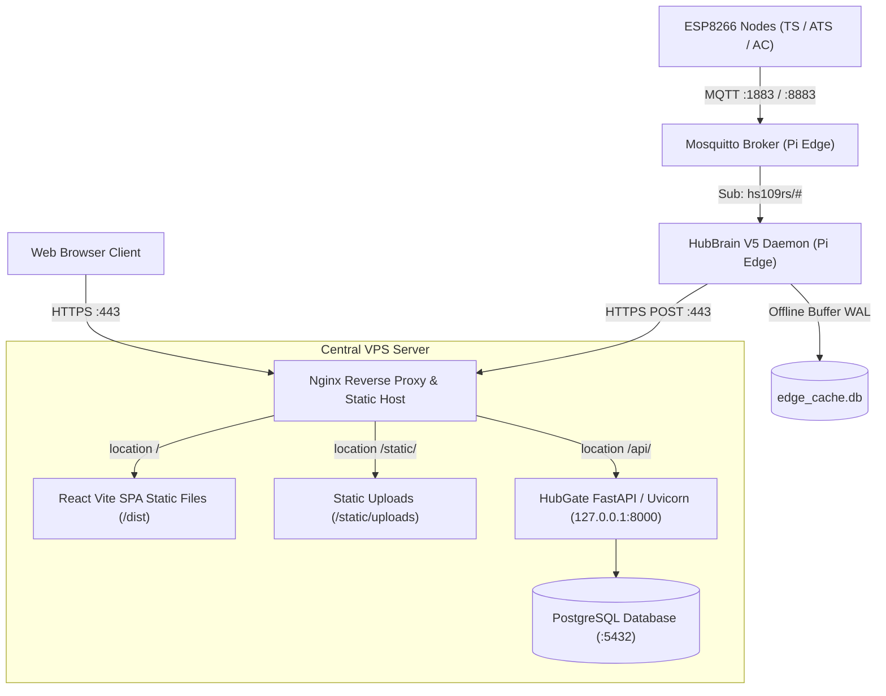

# SMSB Production Deployment & Rollout Guide (Milestone 10)

## 1. System Architecture & Topology

The Smart Monitoring System for Buildings (SMSB) V5 architecture implements a **Same-Origin Production Topology**:



### Key Security & Operational Principles
1. **Same-Origin Serving:** Web SPA and REST API are served on the same origin (`https://<domain-or-ip>`), eliminating cross-origin browser credential issues and enforcing strict `SameSite=Lax` cookie semantics.
2. **Pre-Flight Environment Auditing:** Mandatory `.env` verification tool blocks deployment if placeholder or weak default credentials are present.
3. **VPS First, Edge Last:** The Central Server must be updated, migrated, and verified operational before making any changes to physical edge gateways.
4. **Mandatory Raspberry Pi Backup Gate:** A verified backup archive must be created and copied off-device before modifying edge gateways.

---

## 2. Phase 1: Central VPS Server Setup & Deployment

### Step 1.1: System Prerequisites
Ensure the VPS is running Ubuntu 22.04 LTS / 24.04 LTS (or Debian 12) with required packages:

```bash
# Update repositories and install core packages
sudo apt update && sudo apt install -y \
  python3 python3-venv python3-pip \
  nodejs npm nginx postgresql postgresql-contrib \
  openssl curl git
```

### Step 1.2: Clone / Update Repository
```bash
sudo mkdir -p /opt/smsb
sudo chown -R $USER:$USER /opt/smsb
cd /opt/smsb
git pull origin main
```

### Step 1.3: Configure Production `.env` for Central Server
Create and edit `/opt/smsb/SERVERv5/v5/.env`:

```ini
# Production Central Server Configuration
DATABASE_URL=postgresql://smsb_admin:<STRONG_DB_PASSWORD>@127.0.0.1:5432/smsb_prod
HUB_NAME=hs109rs-hub-01
HUB_KEY=<64_CHAR_HEX_KEY>
```

> [!TIP]
> Generate cryptographically secure keys with:
> `openssl rand -hex 32`

### Step 1.4: Run Automated Production Deployment Script
Execute the orchestration deployment script:

```bash
sudo bash deploy/deploy_production.sh
```

This automated script performs:
1. **Pre-flight Audit:** Runs `python3 tools/verify_prod_env.py --mode prod --target server`.
2. **Frontend Build:** Installs npm dependencies and compiles the React SPA via Vite into `clients/gui-app/dist`.
3. **Database Migration:** Executes additive migrations via `SERVERv5/v5/init_sqlv5.py`.
4. **Nginx Configuration:** Installs `deploy/nginx_smsb.conf`, verifies TLS certificates, tests syntax (`nginx -t`), and reloads Nginx.
5. **Systemd Service:** Installs and starts `hubgate.service` under systemd.

### Step 1.5: Seed Admin User (If Fresh Install)
```bash
cd /opt/smsb/SERVERv5/v5
source venv/bin/activate
python create_admin_user.py --username admin --password "<STRONG_ADMIN_PASSWORD>" --role admin
```

### Step 1.6: Verify Central Server Before Edge Rollout
Verify that the central server is live and responsive:

```bash
python3 tools/verify_production_deployment.py \
  --base-url https://127.0.0.1 \
  --insecure \
  --username admin \
  --password "<STRONG_ADMIN_PASSWORD>" \
  --hub-id hs109rs-hub-01 \
  --hub-key "<64_CHAR_HEX_KEY>"
```

Confirm all steps pass before proceeding to Phase 2.

---

## 3. Phase 2: Raspberry Pi Pre-Flight & Mandatory Backup Gate

> [!CAUTION]
> **NEVER deploy updates to a physical edge gateway without executing the backup gate.**

### Step 2.1: Run Backup Script on the Raspberry Pi
Log in to the Raspberry Pi:

```bash
ssh pi@<PI_IP_ADDRESS>
cd /opt/smsb
sudo bash tools/backup_hub.sh
```

The script archives NetworkManager connections, hostapd/dnsmasq configs, Mosquitto configurations, HubBrain `.env`, certificates, and systemd units into `~/backups/hubbrain_backup_<timestamp>.tar.gz`.

### Step 2.2: Download Archive Off-Device
From your **workstation / laptop**:

```bash
mkdir -p ./pi_backups
scp pi@<PI_IP_ADDRESS>:/home/pi/backups/hubbrain_backup_*.tar.gz ./pi_backups/
scp pi@<PI_IP_ADDRESS>:/home/pi/backups/hubbrain_backup_*.tar.gz.sha256 ./pi_backups/

cd ./pi_backups
sha256sum -c hubbrain_backup_*.tar.gz.sha256
```

Confirm integrity check passes. Only then proceed to Phase 3.

---

## 4. Phase 3: Raspberry Pi Edge HubBrain Deployment

### Step 3.1: Update Edge Codebase
On the Raspberry Pi:

```bash
cd /opt/smsb
git pull origin main
```

### Step 3.2: Configure Production `.env` for HubBrain
Edit `/opt/smsb/HUBV5/V5/.env`:

```ini
# Local Mosquitto Broker
MQTT_HOST=localhost
MQTT_PORT=1883
MQTT_TOPIC=hs109rs/#
MQTT_USER=hubadmin
MQTT_PASS=<STRONG_MQTT_PASSWORD>

# Hub Identity (Must match VPS hub_table)
HUB_NAME=hs109rs-hub-01
HUB_KEY=<64_CHAR_HEX_KEY_MATCHING_VPS>

# Production Central Server Endpoints (HTTPS Port 443 via Nginx)
SERVER_URL=https://<VPS_DOMAIN_OR_IP>/api/iot
SERVER_DEVICES_URL=https://<VPS_DOMAIN_OR_IP>/api/devices
SERVER_ALERT_URL=https://<VPS_DOMAIN_OR_IP>/api/iot/unapproved

# Local Offline WAL Cache
EDGE_CACHE_DB_PATH=edge_cache.db
```

### Step 3.3: Verify Edge Environment
Run the audit script on the Pi:

```bash
python3 tools/verify_prod_env.py --mode prod --target hub
```

Ensure 0 failures are reported.

### Step 3.4: Setup Python Environment & Restart Service
```bash
cd /opt/smsb/HUBV5/V5
if [ ! -d "venv" ]; then
    python3 -m venv venv
fi
source venv/bin/activate
pip install -r requirements.txt --quiet

# Restart HubBrain daemon
sudo systemctl restart hubbrain.service
sudo systemctl status hubbrain.service --no-pager --lines=10
```

---

## 5. Phase 4: Full End-to-End Pipeline Verification

### Step 4.1: Automated Verification Script
Run the pipeline verifier against the production deployment:

```bash
python3 tools/verify_production_deployment.py \
  --base-url https://<VPS_DOMAIN_OR_IP> \
  --username admin \
  --password "<ADMIN_PASSWORD>" \
  --hub-id hs109rs-hub-01 \
  --hub-key "<64_CHAR_HEX_KEY>"
```

### Step 4.2: Edge Telemetry Simulation / Bench Test
From the Pi or test host, publish a test reading to Mosquitto:

```bash
python3 tools/mock_publishers.py --target mqtt --type ts --broker localhost --port 1883 --username hubadmin --password "<MQTT_PASS>" --count 1
```

### Step 4.3: Manual UI Walkthrough
Open `https://<VPS_DOMAIN_OR_IP>` in a browser:
1. **Login:** Log in with `admin` credentials.
2. **Dashboard:** Verify live sensor cards reflect recent temperature/ATS data.
3. **Room Detail:** Confirm 2–5s live polling updates telemetry values.
4. **Map View:** Check floor plan renders with device markers.
5. **Alerts View:** Verify active/historical threshold breach logs.

---

## 6. Disaster Recovery & Rollback Runbook

### Scenario A: Central Server Rollback
```bash
cd /opt/smsb
git checkout <PREVIOUS_STABLE_TAG>
sudo bash deploy/deploy_production.sh --skip-env-check
```

### Scenario B: Raspberry Pi Edge Gateway Restoration
If the Pi loses network configuration or fails to boot cleanly:
```bash
# Upload backup from workstation
scp ./pi_backups/hubbrain_backup_<timestamp>.tar.gz pi@<PI_IP>:/tmp/

# On Pi: restore configs
sudo systemctl stop hubbrain.service mosquitto || true
sudo tar -xzvf /tmp/hubbrain_backup_<timestamp>.tar.gz -P -C /
sudo chmod 600 /etc/NetworkManager/system-connections/* 2>/dev/null || true
sudo systemctl daemon-reload
sudo systemctl restart mosquitto hubbrain.service
```
