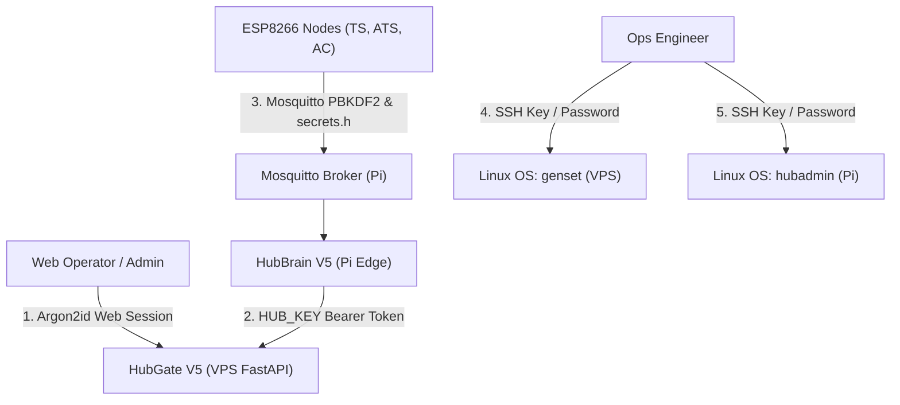

# SMSB Credential Rotation & Handover Runbook

## 1. Overview & Policy

This runbook documents the exact procedures for rotating all secrets, authentication tokens, and passwords across the SMSB (Smart Monitoring System for Buildings) ecosystem prior to final operational handover or in the event of a security audit.

> [!WARNING]
> Production currently operates with initial bootstrap credentials (e.g. `admin / admin123`, shared initial `HUB_KEY`). Prior to exposing the dashboard or commissioning live electrical control, all credentials must be rotated following this guide.

### System Credential Boundaries

The SMSB ecosystem consists of five distinct security zones:



| Security Zone | Location | Mechanism | Primary Rotation Tool |
| :--- | :--- | :--- | :--- |
| **1. Web RBAC Users** | PostgreSQL / SQLite `users` table | Argon2id password hash | `tools/rotate_credentials.py` |
| **2. Hub Ingestion Token** | VPS `server/.env` & Pi `hub/.env` | 64-character hexadecimal `HUB_KEY` | `tools/rotate_credentials.py` |
| **3. MQTT Broker** | `/etc/mosquitto/passwd` & `secrets.h` | PBKDF2-HMAC-SHA512 (`$7$101$`) | `tools/generate_mosquitto_passwd.py` |
| **4. ESP Firmware** | `firmware/*/secrets.h` | Plaintext in C++ compiled flash | Arduino IDE / esptool / avrdude |
| **5. Linux OS Logins** | `/etc/shadow` (VPS & Pi) | Linux PAM crypt (sha512crypt) | `passwd` CLI command |

---

## 2. Pre-Rotation Backup Gate

Before rotating any credentials, take snapshots of both the VPS database and the edge gateway configuration.

### On the Raspberry Pi (Edge Gateway):
Follow [HUB_BACKUP_GUIDE.md](file:///c:/Users/Mizan/Documents/smsb/docs/HUB_BACKUP_GUIDE.md):
```bash
ssh hubadmin@10.33.102.10
sudo bash /opt/smsb/tools/backup_hub.sh
```

### On the Central VPS:
```bash
ssh genset@100.108.98.30
# If using SQLite:
cp /opt/smsb/server/hubgatev5.db /opt/smsb/server/hubgatev5.db.bak_$(date +%Y%m%d_%H%M%S)

# If using PostgreSQL:
pg_dump -U smsb_admin -d smsb_prod -F c -b -v -f ~/smsb_prod_backup_$(date +%Y%m%d).dump
```

---

## 3. Step-by-Step Rotation Procedure

### Phase 1: Web Users & `HUB_KEY` Rotation

Use the automated CLI tool `tools/rotate_credentials.py`.

#### Step 1.1: Perform a Dry Run
Simulate the generation of cryptographically secure passwords and 64-character hex `HUB_KEY` without making any database or filesystem changes:
```bash
python tools/rotate_credentials.py --dry-run
```

For development or staging environments where default test accounts must be preserved, use:
```bash
python tools/rotate_credentials.py --dry-run --keep-dev-logins
```

#### Step 1.2: Apply Changes to Database and Server `.env`

**On SQLite (Local / Staging VPS):**
```bash
python tools/rotate_credentials.py \
  --target-db /opt/smsb/server/hubgatev5.db \
  --update-env /opt/smsb/server/.env \
  --hub-id hs109rs-hub-01
```

**On PostgreSQL (Production VPS):**
```bash
python tools/rotate_credentials.py \
  --target-db "postgresql+psycopg2://smsb_admin:<DB_PASS>@127.0.0.1:5432/smsb_prod" \
  --update-env /opt/smsb/server/.env \
  --hub-id hs109rs-hub-01
```

*What this tool does automatically:*
1. Generates 24-character high-entropy passwords for `admin`, `operator`, and `viewer`.
2. Hashes them using Argon2id (`argon2-cffi`).
3. Updates `users` table, resets `failed_login_attempts` to 0, and clears lockouts.
4. Truncates the `sessions` table (immediately invalidating all active browser logins).
5. Clears `login_attempts` brute-force tracking.
6. Generates a new 64-character hex token (`secrets.token_hex(32)`) and updates `hub_table.hub_key`.
7. Updates `HUB_KEY=<token>` in `server/.env`.
8. Prints the generated plaintext passwords and operational runbook.

> [!IMPORTANT]
> Immediately record the printed plaintext passwords in a secure password manager (e.g. Bitwarden, 1Password). Plaintext passwords cannot be retrieved once the terminal is cleared.

#### Step 1.3: Restart HubGate Backend Service
```bash
sudo systemctl restart smsb-api
```
Verify the health check endpoint returns `401 Unauthorized` for unauthenticated requests:
```bash
curl -k https://127.0.0.1:8000/api/auth/me
```

---

### Phase 2: Synchronize Edge Gateway (`HUB_KEY`)

The Raspberry Pi HubBrain daemon requires the identical `HUB_KEY` to authenticate batch telemetry syncs (`POST /api/iot/batch`) and fetch downlink commands (`GET /api/hub/commands`).

#### Step 2.1: Update Pi `.env`
Log in to the edge gateway:
```bash
ssh hubadmin@10.33.102.10  # (or 10.33.36.81)
nano /home/hubadmin/hub/.env
```
Update the `HUB_KEY` line with the new 64-hex key generated in Phase 1:
```ini
HUB_KEY=49beac7c0af21a491ee801c0494e4e65ef7a163d2e8f085f859bada6dc69e146
```

#### Step 2.2: Restart HubBrain Daemon
```bash
sudo systemctl restart hubbrain
```

#### Step 2.3: Verify Real-Time Edge Sync
Inspect the journal logs to ensure successful HTTP 200 telemetry commits:
```bash
journalctl -u hubbrain -n 30 --no-pager | grep "SYNC"
```
You should see:
```text
[SYNC SUCCESS] Uploaded batch of 15 points to server. Status: 200 OK.
```

---

### Phase 3: Mosquitto MQTT Password & ESP Node Reflash

The ESP8266 nodes (`TS`, `ATS`, `AC`) publish telemetry to Mosquitto on the Raspberry Pi using username `hubadmin` and password defined in `secrets.h`.

#### Step 3.1: Generate New PBKDF2 Password File Entry
On the Raspberry Pi (or workstation):
```bash
python3 tools/generate_mosquitto_passwd.py \
  --user hubadmin \
  --password "<NEW_SECURE_MQTT_PASSWORD>" \
  --file /etc/mosquitto/passwd
```

#### Step 3.2: Reload Mosquitto Broker
```bash
sudo systemctl reload mosquitto
```

#### Step 3.3: Update Pi HubBrain MQTT Connection
Update `MQTT_PASS` in `/home/hubadmin/hub/.env`:
```ini
MQTT_PASS=<NEW_SECURE_MQTT_PASSWORD>
```
Restart HubBrain:
```bash
sudo systemctl restart hubbrain
```

#### Step 3.4: Update ESP8266 Firmware `secrets.h` & Reflash
Edit the header files:
- `firmware/WEMOS_TS/secrets.h`
- `firmware/WEMOS_ATS/secrets.h`
- `firmware/WEMOS_AC/secrets.h`

Update the password macro:
```c
#define MQTT_PASS "<NEW_SECURE_MQTT_PASSWORD>"
```

Reflash each physical node using serial cable or programmer:
- ATS controller: WEMOS D1 Mini via USB (`esptool.py` or Arduino CLI)
- Temperature sensor: NodeMCU / D1 Mini
- AC controller: NodeMCU

Verify the nodes reconnect and publish telemetry:
```bash
mosquitto_sub -h 127.0.0.1 -u hubadmin -P "<NEW_SECURE_MQTT_PASSWORD>" -t "hs109rs/#" -v
```

---

### Phase 4: Host OS Password Rotation (SSH)

Rotate the Linux operating system user passwords on all physical hardware and servers.

#### Step 4.1: Central VPS (`genset`)
```bash
ssh genset@100.108.98.30
passwd genset
# Enter current password, then enter and confirm the new secure password
```

#### Step 4.2: Raspberry Pi Edge Gateway (`hubadmin`)
```bash
ssh hubadmin@10.33.102.10
passwd hubadmin
# Enter current password, then enter and confirm the new secure password
```

---

## 4. Verification & Audit Checklist

Once rotation is complete, run the automated environment verifier:

```bash
# Verify Central Server environment
python tools/verify_prod_env.py --mode prod --target server

# Verify Edge Gateway environment
python tools/verify_prod_env.py --mode prod --target hub
```

### Manual Verification Checklist:
- [ ] Attempt web login with legacy `admin123` password (must return 401 / Invalid credentials).
- [ ] Log in with new `admin` password via `https://10.33.102.172/` (dashboard loads successfully).
- [ ] Confirm `curl -k https://127.0.0.1:8000/api/auth/me` returns 401 when no session cookie is provided.
- [ ] Confirm HubBrain logs show continuous `[SYNC SUCCESS]` with the new `HUB_KEY`.
- [ ] Verify MQTT topic traffic on Pi broker: `mosquitto_sub -t "hs109rs/#"` receives sensor payloads.
- [ ] Confirm SSH key-based access works for both VPS and Pi.
