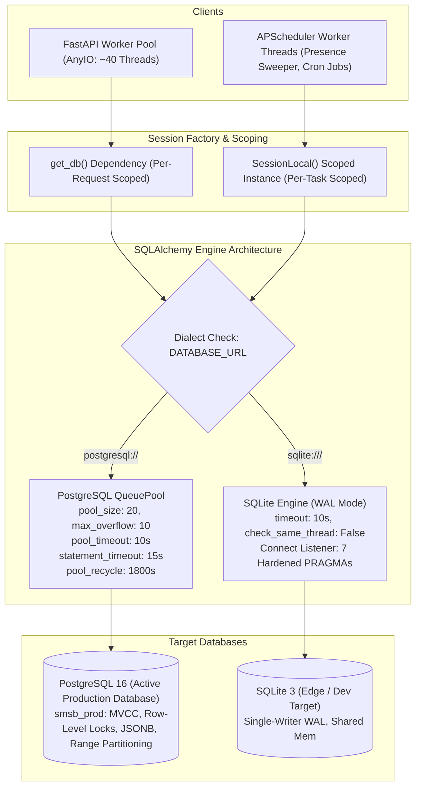
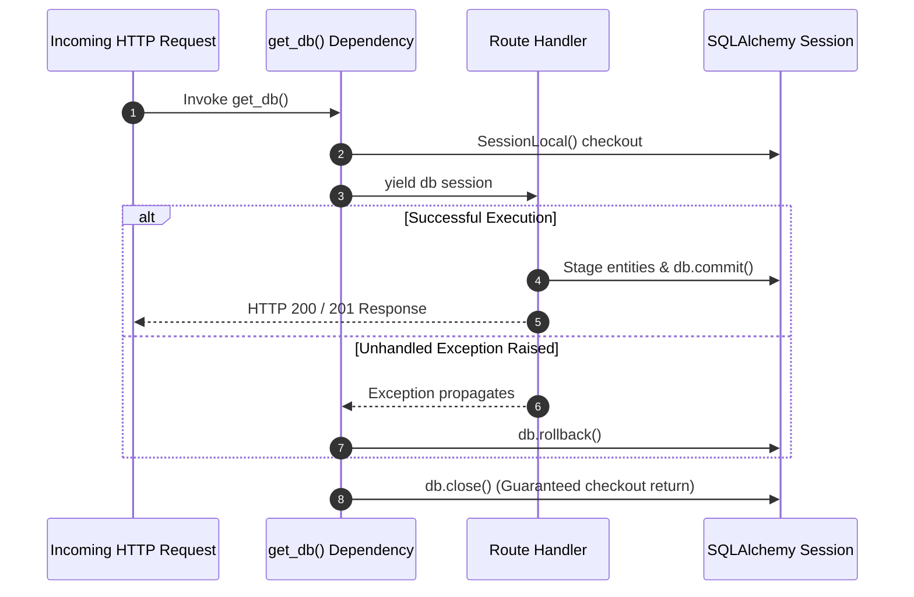
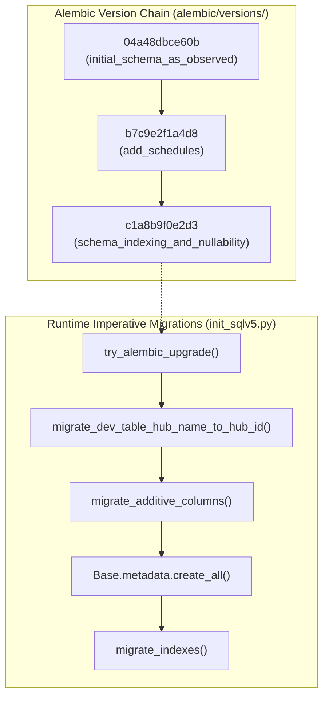

# HubGate V5 Database Lifecycle & Persistence Architecture

HubGate V5 persists high-frequency time-series telemetry, device inventory, relational hierarchy (hubs, rooms, devices), operational events, scheduled automation jobs, and user sessions. The persistence layer in `server/databasev5.py` operates a dual-dialect engine architecture supporting **PostgreSQL 16** as the active, live production database on the VPS and **SQLite 3 WAL** for single-node edge and development environments.



---

## 1. Dual-Dialect Engine & Connection Pool Architecture

The database engine is instantiated via `get_engine_kwargs(DATABASE_URL)` in `server/databasev5.py`, configuring distinct pooling, query timeout, and driver parameters based on the connection scheme.

### PostgreSQL 16 (Active Production Database)
- **Deployment Host**: Dedicated VPS instances (`100.108.98.30` / `10.33.102.172`). Active database: `smsb_prod`.
- **Hardware Specification & Co-Tenancy Profile**: Hosted on an 8 GB Dynamic RAM / 4 vCPUs VPS, configured with a 4 GB allocation profile for SMSB (reserving 4 GB for CTFd co-tenancy). Uvicorn runs under systemd cgroup limits `MemoryHigh=1.2G`, `MemoryMax=1.8G`.
- **Hardened Connection Pool Bounds (`QueuePool`)**:
  - `pool_size = 20` (default, overridable via `DB_POOL_SIZE`): Baseline persistent connection pool maintained across requests.
  - `max_overflow = 10` (`DB_MAX_OVERFLOW`): Upper limit of temporary burst connections created under surge traffic. Total connection ceiling is 30.
  - `pool_timeout = 10` (`DB_POOL_TIMEOUT`): Fast-failing pool checkout timeout preventing worker threads from blocking indefinitely under surge load.
  - `pool_recycle = 1800` (`DB_POOL_RECYCLE`): Automatically tears down and recreates connections every 30 minutes to prevent server-side TCP timeout drops.
  - `pool_pre_ping = True`: Emits a lightweight `SELECT 1` heartbeat prior to checking out a connection, proactively evicting broken sockets.
- **Statement Timeout Guard**:
  - Configured via connection options: `-c statement_timeout=15000` (15 seconds, overridable via `DB_STATEMENT_TIMEOUT_MS`).
  - Aborts any unindexed or runaway analytics query that exceeds 15 seconds, protecting database workers from connection starvation.
- **Fail-Fast Production Check**: If `ENV=prod` and `DATABASE_URL` is omitted or points to SQLite, HubGate V5 raises `RuntimeError` at module import and halts initialization.

### SQLite 3 WAL Mode (Edge / Local Dev)
- **Driver Tuning**: `check_same_thread = False`, `timeout = 10.0` (client-side driver lock acquisition ceiling).
- **Hardened Connection-Time PRAGMA Listener**: Attached via SQLAlchemy `@event.listens_for(engine, "connect")`:
  - `PRAGMA journal_mode = WAL;`: Write-Ahead Logging allows concurrent readers to query snapshots while a single writer thread operates without blocking reads.
  - `PRAGMA busy_timeout = 10000;`: Configures a 10-second wait before raising `sqlite3.OperationalError: database is locked`.
  - `PRAGMA synchronous = NORMAL;`: Safely minimizes disk sync flushes to WAL checkpoints, improving write IOPS while maintaining durability against power loss or crashes.
  - `PRAGMA foreign_keys = ON;`: Enforces relational integrity (`ON DELETE CASCADE` on child tables).
  - `PRAGMA temp_store = MEMORY;`: In-memory temporary tables and sorting buffers.
  - `PRAGMA cache_size = -8000;`: Allocates 8MB memory page cache, tuned for the edge/dev memory envelope (reduced from legacy 64MB).
  - `PRAGMA mmap_size = 67108864;`: Allocates 64MB memory-mapped file access, preventing virtual memory exhaustion on memory-constrained hosts (reduced from legacy 256MB).

### Hourly SQLite WAL Maintenance Job
- In SQLite WAL mode, continuous telemetry ingestion and concurrent analytical reads can impede automatic checkpoints, causing `hubgatev5.db-wal` to grow indefinitely on disk.
- HubGate V5 deploys a scheduled maintenance worker `checkpoint_sqlite_wal` in `server/app/services/scheduler.py` registered as APScheduler job `engine-sqlite-wal-checkpoint`.
- The job executes hourly:
  ```python
  if IS_SQLITE:
      with engine.connect() as conn:
          conn.execute(text("PRAGMA wal_checkpoint(TRUNCATE);"))
          conn.commit()
  ```
- This forces a checkpoint truncation, flushes all pending WAL frames into the main database file, and resets the WAL file size to 0 bytes, reclaiming disk space without interrupting active readers.

### Connection Sizing & Pool Starvation Analysis
- **Worker-to-Connection Ratio**: FastAPI executes synchronous endpoint handlers (`def`) in AnyIO's threadpool, which defaults to 40 worker threads. Additionally, APScheduler runs background threads (presence sweeper every 15 seconds, schedule jobs, etc.).
- **Hardened Headroom**: Under the hardened pool configuration (`pool_size=20, max_overflow=10`, total 30 connections with `pool_timeout=10s`), concurrent HTTP requests and background workers operate with ample connection headroom, eliminating checkout starvation risks.

---

## 2. Database Session Lifecycle & Transaction Scoping

FastAPI route handlers and background tasks adhere to explicit session scoping to ensure transaction atomicity and prevent connection checkout leaks:



### Request-Scoped Session Dependency (`get_db`)
```python
def get_db():
    db = SessionLocal()
    try:
        yield db
    except Exception:
        db.rollback()
        raise
    finally:
        db.close()
```
- **Automatic Rollback**: Any unhandled exception (HTTPException, validation error, database error) triggers an immediate rollback, preventing dirty session states from contaminating subsequent queries.
- **Deterministic Resource Teardown**: The `finally: db.close()` block guarantees that connection checkouts are returned to the pool even during process aborts or client disconnections.

### The Single Atomic Commit Invariant
In earlier iterations, helper dependencies or secondary services performed intermediate commits (e.g. `verify_hub_identity` committing `hub.last_seen`), creating lock collisions (CRIT-01) and leaving orphaned records on failures. In HubGate V5:
1. **Dependency Staging**: Dependencies only mutate ORM entity state in memory (`stage_hub_heartbeat`).
2. **Atomic Ingestion Commit**: In `POST /api/iot` and `POST /api/iot/batch`, hub heartbeat update, telemetry record insertion (`bulk_insert_or_ignore`), presence state update (`resolve_offline_on_telemetry`), and alert evaluation (`evaluate_device_thresholds`) commit in a single, unified `db.commit()` call.
3. **Idempotent Bulk Upsert**: `bulk_insert_or_ignore` inserts records in chunks of 500 (`chunk_size=500` to remain safely below SQLite variable binding limits) using `ON CONFLICT (dev_id, timestamp) DO NOTHING` on PostgreSQL and SQLite, ensuring WAL replays cause no duplicates or rollbacks.
4. **Device Ownership Enforcement (`SEC-06`)**: Prior to staging or inserting records, `receive_iot` and `receive_iot_batch` verify that `device.hub_id == hub.hub_id`. Telemetry from an unassociated device is rejected (HTTP 403 in single ingest, or skipped with incremented `ignored_count` in batch ingest) with security warning logging, executing zero database write operations for unauthorized payloads.

### Background Worker Session Discipline
Background tasks run in independent, isolated database sessions to prevent cross-thread session bleeding:
- **Presence Sweeper (`evaluate_device_presence_batch`)**: Scheduled every 5 seconds. Opens `db = SessionLocal()`, executes batch scans, prunes stale pending nodes with a bulk `delete()`, commits state transitions, and guarantees `finally: db.close()`.
- **APScheduler Execution (`fire_schedule`)**: Triggered by cron triggers. Opens a fresh `SessionLocal()`, inserts `pending_commands`, updates `schedules.next_run_at`, commits, and closes the session.

### Session Sliding Window Throttling (`SEC-10`) & Write-on-Read Elimination
Previously, every request authenticated via session cookie in `server/auth.py` executed `UPDATE sessions SET expires_at = ...` and `db.commit()`. On SQLite WAL, this forced an EXCLUSIVE write lock on every GET request, transforming concurrent read traffic into a serialized write bottleneck.

This is resolved via **Sliding Window Throttling**:
- `verify_session` inspects `remaining_validity = expires_at - now`.
- A database write transaction and `db.commit()` are executed **only** if `remaining_validity < timedelta(minutes=90)`.
- Inbound requests with fresh sessions ($\ge 90$ minutes remaining) skip the database write completely.
- This eliminates the write-on-read lock in SQLite WAL and dramatically reduces UPDATE churn and VACUUM pressure in PostgreSQL.

---

## 3. Concurrency Mechanics: PostgreSQL 16 vs SQLite 3 WAL

| Architectural Dimension | PostgreSQL 16 (Production) | SQLite 3 WAL (Local / Edge) |
|---|---|---|
| **Concurrency Model** | Multi-writer MVCC (Multi-Version Concurrency Control) with row-level locks. | Single-writer serialization with multi-reader WAL concurrency. |
| **Write Lock Contention** | Near-zero between distinct rows; transactions commit concurrently across connections. | Concurrent writers block until the active writer commits or 10s `busy_timeout` expires. |
| **Connection Pooling** | `QueuePool` with hardened sizing (`pool_size=20, max_overflow=10, pool_timeout=10s`). | Thread-local connections via `NullPool` or `SingletonThreadPool` with `timeout=10.0s`. |
| **JSON Storage Engine** | Binary JSON (`JSONB`), supporting native GIN indexing and expression extraction. | Text JSON (`JSON`), parsed dynamically on read. Configured via `JSONB().with_variant(JSON, "sqlite")`. |
| **Timestamp Semantics** | `TIMESTAMP WITH TIME ZONE` stores native aware UTC timestamps. | String-based `TIMESTAMP` returning naive UTC datetimes, requiring defensive timezone normalization. |
| **Variable Binding Limits** | 65,535 parameters per query. | 999 parameters (SQLite < 3.32) or 32,766 (modern SQLite). Bounded by 500 chunking. |
| **Epoch Downsampling Math** | `CAST(FLOOR(EXTRACT(epoch FROM col) / bucket_seconds) * bucket_seconds AS INTEGER)` | `(CAST(func.unixepoch(col) / bucket_seconds, Integer) * bucket_seconds)` |
| **Unique Constraint Backing** | Backed by PostgreSQL B-tree unique index `ON CONFLICT (dev_id, timestamp)`. | Backed by SQLite unique index with automatic startup duplicate deduplication. |

---

## 4. Migration Discipline, Dual-Path Architecture & Drift Risks

HubGate V5 currently maintains two distinct schema migration mechanisms: an Alembic migration chain and imperative runtime migration routines in `server/init_sqlv5.py`.



### Alembic Migration Inventory
1. `04a48dbce60b_initial_schema_as_observed.py`: Base migration representing observed state.
2. `b7c9e2f1a4d8_add_schedules.py`: Adds `schedules` table with dialect-aware JSON/JSONB column and composite indexes.
3. `c1a8b9f0e2d3_schema_indexing_and_nullability.py`: Converts `temperature_data` (`temp`, `humid`) to `nullable=True` and applies composite SARGable performance indexes across `event_log`, `dev_table`, `pending_commands`, and `data_table`.

### Identified Production Migration Gaps & Drift Risks

#### MIG-01: Non-Deterministic Initial Alembic Revision
- **Mechanism**: In `04a48dbce60b`, `upgrade()` executes `Base.metadata.create_all(bind=bind)`.
- **Drift Risk**: `create_all` inspects the live Python ORM definitions in `modelsv5.py` at execution time rather than applying fixed DDL operations. If new models are added, running migrations from scratch will create all tables up-front, rendering subsequent Alembic revisions redundant or causing collision errors on incremental upgrades.

#### MIG-02: Dual-Path Migration Conflict
- **Mechanism**: `server/init_sqlv5.py` and `databasev5.migrate_indexes()` run raw imperative SQL scripts on gateway startup (`init_db()`, `scheduler_lifespan`), altering columns (`migrate_additive_columns`) and creating indexes (`migrate_indexes`).
- **Drift Risk**: Schema alterations occur outside the `alembic_version` tracking table. Automated CI or production deployment pipelines running `alembic upgrade head` can drift out of synchronization with nodes initialized via `init_sqlv5.py`.

#### MIG-03: Asymmetric In-Database Deduplication
- **Mechanism**: `init_sqlv5.migrate_indexes()` executes duplicate pruning before creating unique constraints:
  ```sql
  DELETE FROM tbl WHERE rowid NOT IN (SELECT MIN(rowid) FROM tbl GROUP BY dev_id, timestamp)
  ```
- **Drift Risk**: The query is guarded by `dialect.name == "sqlite"` because PostgreSQL does not have a `rowid` pseudocolumn. On PostgreSQL, if duplicate `(dev_id, timestamp)` records exist prior to applying unique constraints, unique index creation fails with `IntegrityError` without fallback deduplication.

#### MIG-04: Missing Unique Constraints in Alembic Migrations
- **Mechanism**: While composite lookup indexes were migrated in `c1a8b9f0e2d3`, unique indexes `uq_temp_dev_timestamp`, `uq_ats_dev_timestamp`, and `uq_data_dev_timestamp` were omitted from Alembic revision `c1a8b9f0e2d3`. They are only created via `init_sqlv5.py:migrate_indexes()`.
- **Drift Risk**: Deployments executing strictly `alembic upgrade head` lack the unique constraints required to support PostgreSQL and SQLite `ON CONFLICT DO NOTHING` statements in `bulk_insert_or_ignore`, causing bulk telemetry ingestion to fail with syntax or integrity errors.

---

## 5. High-Throughput Query Patterns & SARGable Optimization

HubGate V5 eliminates table-wide linear scans by aligning queries with composite B-tree indexes:

### 1. Downsampling V2 Epoch Bucketing
- **Path**: `GET /api/devices/{id}/history`
- **Pattern**: Evaluates time spans (6h to 30d) in a single SQL pass:
  ```sql
  SELECT 
      CAST(FLOOR(EXTRACT(epoch FROM timestamp) / :bucket_sec) * :bucket_sec AS INTEGER) AS bucket_ts,
      AVG(temp) AS temp, MIN(temp) AS temp_min, MAX(temp) AS temp_max,
      AVG(humid) AS humid, MIN(humid) AS humid_min, MAX(humid) AS humid_max
  FROM temperature_data
  WHERE dev_id = :dev_id AND timestamp BETWEEN :start AND :end
  GROUP BY bucket_ts ORDER BY bucket_ts ASC;
  ```
- **Index Utilized**: `idx_temp_dev_timestamp(dev_id, timestamp DESC)` and `idx_ats_dev_timestamp(dev_id, timestamp DESC)`. B-tree prefix match isolates the device, while range scan extracts time boundaries without reading extraneous data.

### 2. Room Sparklines Two-Pass CTE
- **Path**: `GET /api/rooms/sparklines`
- **Pattern**: A single-query two-pass Common Table Expression (CTE). Pass 1 aggregates per-device averages into `device_bucket_agg`; Pass 2 groups by room and calculates room `MAX` envelopes for temperature and humidity, eliminating N+1 queries across facility rooms.

### 3. Batched Device Latest Reading (`get_latest_readings_for_devices`)
- **Path**: Shared service used by `GET /api/devices` and `GET /api/rooms/{id}/map`.
- **Pattern**: Replaces iterative per-device queries with 3 set-based subquery joins (for TS, ATS, and AC controllers):
  ```sql
  SELECT t.* FROM temperature_data t
  JOIN (
      SELECT dev_id, MAX(timestamp) AS max_ts 
      FROM temperature_data 
      WHERE dev_id IN (:dev_ids) 
      GROUP BY dev_id
  ) sub ON t.dev_id = sub.dev_id AND t.timestamp = sub.max_ts;
  ```
- **Performance**: Fetches the latest live state for 100 devices in under 5ms.

### 4. Eager Loading Invariants
- `GET /api/devices` explicitly loads relations via `selectinload(dev_table.threshold_config)` and `selectinload(dev_table.room)`, eliminating lazy-load connection churn during response serialization.
- `GET /api/rooms/{id}/map` loads paired devices using `joinedload(rooms.devices)` in a single database round-trip.

---

## 6. High-Speed Streaming SQLite to PostgreSQL 16 Migration Pipeline (`COPY FROM STDIN`)

To transition production from SQLite 3 WAL to PostgreSQL 16 MVCC without memory bloat or transaction loss, HubGate V5 provides a dedicated streaming migration engine (`tools/migrate_sqlite_to_postgres.py`) governed by the operational cutover runbook (`docs/runbooks/postgres_cutover_runbook.md`).

### 6.1 Architectural Highlights
- **Native Streaming `copy_expert` Pipeline**: Replaced legacy multi-row INSERTs with memory-buffered CSV streaming via `psycopg2.cursor.copy_expert()`. SQLite cursors are fetched in chunks of 25,000 rows (`fetchmany(25000)`), converted to in-memory CSV buffers (`io.StringIO`), and piped via `COPY "{pg_tbl}" (...) FROM STDIN WITH (FORMAT CSV, HEADER FALSE, NULL '\N')`. Peak memory footprint remains strictly under **45MB RAM**, eliminating OOM risk and preserving memory headroom for co-tenant workloads (such as CTFd on the 4GB allocation profile).
- **Secondary Index Deferral**: The migration tool inspects `pg_index` and drops secondary B-Tree and BRIN indexes on telemetry tables (`data_table`, `temperature_data`, `ats_data`) prior to ingestion, retaining only primary composite keys `(data_id, timestamp)` and unique constraints. After streaming completes, dropped indexes are reconstructed across the partition hierarchy in a single sequential heap scan pass (`rebuild_telemetry_secondary_indexes`).
- **PostgreSQL 16 Partition Auto-Routing**: Data is streamed directly into parent tables. PostgreSQL 16 automatically routes incoming records into appropriate monthly child partitions based on event timestamp.
- **Pre-Cutover Session Optimizations**:
  - `SET session_replication_role = 'replica';` (bypasses foreign key checks and triggers during ingestion).
  - `SET synchronous_commit = off;` (eliminates WAL disk sync latency).
  - `SET maintenance_work_mem = '256MB';` (accelerates subsequent index rebuilds).
- **Strict Data Sanitization**:
  - Timestamps: Casts unadorned SQLite ISO strings and epoch floats to timezone-aware UTC datetime instances (`datetime.timezone.utc`).
  - Booleans: Converts SQLite integer flags (`0` / `1`) to native Python booleans for PostgreSQL boolean columns (`is_active`, `enabled`).
  - JSON Payloads: Validates schema definitions and serializes dictionary structures into native PostgreSQL `JSONB`.
- **PostgreSQL Sequence Synchronization & VACUUM**: Resynchronizes all serial and identity sequences (`SELECT setval(...)`), restores session variables (`session_replication_role = 'origin'`, `synchronous_commit = on`), and executes `VACUUM ANALYZE` across all tables under `autocommit = True`.
- **Verification & Parity Reporting**: Runs an automated table parity audit comparing source SQLite row counts against target PostgreSQL row counts across all 14 canonical tables, reporting PASS/FAIL status.
- **Non-Destructive Dry-Run**: The `--dry-run` flag parses tables, validates types, tests transformations, and benchmarks extraction speeds with zero writes to the target PostgreSQL cluster.

### 6.2 Completed Live Production Cutover Execution
On 2026-09-12, the production database on the VPS (`100.108.98.30`) successfully cut over from SQLite 3 WAL to PostgreSQL 16 (`smsb_prod`):
- **Data Parity**: **4,152,334 rows** were migrated across all 14 canonical tables with **100% row parity** (0 dropped rows, 0 data drift).
- **Execution Performance**: Streaming in chunks of 25,000 rows completed full data transfer within the planned maintenance window with a peak memory footprint under 45MB RAM.
- **Partition Verification**: High-volume telemetry was routed into monthly range partitions (`temperature_data_y2026m08`, `temperature_data_y2026m09`, etc.) with BRIN indexes auto-summarized.
- **Resource Envelope**: Operational under the 4 GB allocation profile on the 8 GB Dynamic RAM / 4 vCPUs VPS host, cleanly reserving 4 GB for CTFd co-tenancy.
- **Fallback State**: The previous SQLite database file `/opt/smsb/server/hubgatev5.db` was preserved in a read-only state as an immutable cold backup.

---

## 7. Declarative Range Partitioning & Automated Retention Lifecycle

HubGate V5 implements PostgreSQL 16 native declarative range partitioning across high-volume telemetry tables (`data_table`, `temperature_data`, `ats_data`):

### 7.1 Composite Primary Keys & Dialect Transparency
Under PostgreSQL 16, range-partitioned tables require the partition key to be part of every unique and primary key constraint. All telemetry models define:
```python
PRIMARY KEY (data_id, timestamp)
```
with `__table_args__ = {"postgresql_partition_by": "RANGE (timestamp)"}`. SQLite 3 WAL seamlessly ignores the PostgreSQL partition directive while natively enforcing the composite primary key.

### 7.2 BRIN Indexing (`pages_per_range = 32, autosummarize = True`)
Telemetry tables employ Block Range Indexes (BRIN) on the monotonic `timestamp` column alongside composite B-Tree indexes:
- Compact storage: < 128KB per monthly partition (compared to tens of megabytes for B-Trees).
- Fast range query filtering across large historical blocks.

### 7.3 Automated Partition Lifecycle Manager (`app/services/partition_manager.py`)
- **Avoidance of DEFAULT Partition**: Under PostgreSQL 16, `DETACH PARTITION ... CONCURRENTLY` is disallowed if a `DEFAULT` partition exists. HubGate V5 avoids creating a `DEFAULT` partition, maintaining instead a rolling 60-day buffer of forward child partitions (`T+1`, `T+2`) and bounding timestamps at ingestion (`[-35d, +24h]`).
- **Precreation**: Daily job automatically verifies and generates monthly child partitions for `T`, `T+1`, and `T+2`.
- **O(1) Concurrent Pruning**: Partitions older than 30 days are pruned via:
  1. `ALTER TABLE "<parent>" DETACH PARTITION "<child>" CONCURRENTLY;` (non-blocking O(1) detachment).
  2. `DROP TABLE IF EXISTS "<child>";` (instant disk reclamation without VACUUM).
- **SQLite Transparency**: Bypasses cleanly when running on SQLite (`IS_SQLITE`).
