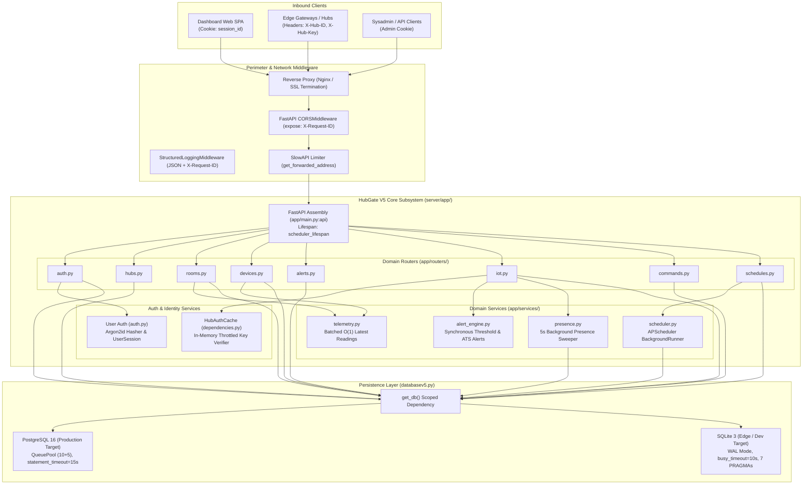
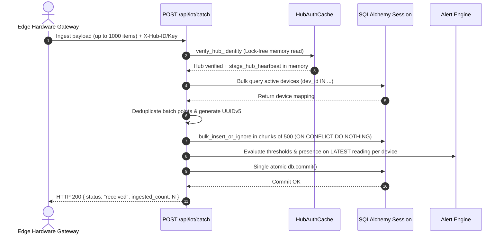

# HubGate V5 (server/)

HubGate V5 is the centralized FastAPI gateway and persistence subsystem of the smsb stack, located in `server/`. The canonical application entrypoint is `app.main:api`, with `hubgatev5.py` retained as a 20-line backward-compatibility stub re-exporting `api`. It terminates telemetry ingestion from edge hardware hubs, provides the REST API consumed by the web dashboard SPA, handles user authentication and throttled session management, emits structured single-line JSON logs with `X-Request-ID` tracing, manages hardware downlink commands, executes scheduled automations, and maintains relational and time-series persistence.

---

## 1. Domain Routers & Service Orchestration

HubGate V5 decouples route handling (`server/app/routers/`) from domain logic (`server/app/services/`):

### 1. Domain Routers (`server/app/routers/`)
- **`auth.py`**: Handles user login (`POST /api/auth/login`), logout (`POST /api/auth/logout`), and profile queries (`GET /api/auth/me`). Manages Argon2id password verification, brute-force account lockouts (5 failed attempts $\to$ 15 min lock), and session cookie emission (`session_id`).
- **`hubs.py`**: Manages hub provisioning (`POST /api/admin/hubs`), edge pairing (`POST /api/hubs/pair`), lifecycle states (`approve`, `revoke`), room assignments (`/api/gateways/{id}/room`), and hard deletion (`DELETE /api/hubs/{id}`).
- **`rooms.py`**: Manages room hierarchy (`POST`, `PATCH`, `DELETE /api/rooms`), device association counts, floor plan asset uploads (`POST /api/rooms/{id}/floor-plan`), live marker mapping (`GET /api/rooms/{id}/map`), and facility sparklines (`GET /api/rooms/sparklines`).
- **`devices.py`**: Coordinates device approval (`POST /api/devices/{id}/approve`), pairing coordinates (`POST /api/devices/{id}/pair`), threshold configurations (`PUT /api/devices/{id}/thresholds`), live inventory querying (`GET /api/devices`), and Downsampling V2 telemetry retrieval (`GET /api/devices/{id}/history`).
- **`alerts.py`**: Serves paginated, filtered audit logs (`GET /api/alerts`) over `event_log` with multi-room, multi-device, severity (`warning`, `critical`), and status (`open`, `resolved`) filter dimensions.
- **`iot.py`**: High-throughput telemetry ingestion terminating single-item payloads (`POST /api/iot`), batch payloads (`POST /api/iot/batch`), and unapproved device alerts (`POST /api/iot/unapproved`).
- **`commands.py`**: Queues downlink hardware commands (`POST /api/devices/{id}/command`) with role gating (`admin` for reset, `operator` for state change), provides edge command polling (`GET /api/hub/commands`), and delivery acknowledgment (`POST /api/hub/commands/{id}/delivered`).
- **`schedules.py`**: CRUD interface for cron automation jobs (`POST`, `GET`, `PATCH`, `DELETE /api/schedules`), cron fire preview calculations (`GET /api/schedules/preview`), and manual triggers (`POST /api/schedules/{id}/run-now`).

### 2. Service Subsystems (`server/app/services/`)
- **`alert_engine.py`**: Synchronously evaluates incoming telemetry against configured warning/critical thresholds and ATS emergency states. Features temporal debouncing (`debounce_seconds`) to eliminate flapping and hysteresis recovery (`warning - hysteresis`) to guarantee single alert resolution transitions.
- **`presence.py`**: Decoupled connectivity engine running every 5 seconds via APScheduler. Scans active devices against a 25-second inactivity window, emitting `DEVICE_OFFLINE` alerts and resolving returning devices. Also prunes stale unapproved devices in bulk.
- **`scheduler.py`**: APScheduler `BackgroundScheduler` operating in the canonical `Asia/Jakarta` timezone (`JOB_DEFAULTS: coalesce=True, max_instances=1, misfire_grace_time=60`). Rehydrates enabled schedules from the database on gateway startup, generates pending commands when triggered, and supports optional `SQLAlchemyJobStore` on PostgreSQL.
- **`telemetry.py`**: Set-based query service (`get_latest_readings_for_devices`) executing 3 subquery joins across `temperature_data`, `ats_data`, and `data_table`, replacing N+1 per-device queries with a single $O(1)$ batch query.

---

## 2. Ingestion Pipeline, Idempotency & Downsampling V2

### Telemetry Ingestion Contract
- **Single Ingest (`POST /api/iot`)**: Ingests discriminated payloads (`TSData`, `ATSData`, or generic `IotPayload`) with rate limiting (`120/minute`). Enforces `SEC-06` device ownership verification (`registered_device.hub_id == hub.hub_id`), raising HTTP 403 on mismatch. Resolves device presence, inserts records via dialect-agnostic upsert, and evaluates thresholds in a single atomic database commit.
- **Batch Ingest (`POST /api/iot/batch`)**: Accepts up to 1000 records per invocation (`60/minute` rate limit). Enforces `SEC-06` device ownership verification (`dev_obj.hub_id == hub.hub_id`), logging security warnings, skipping unauthorized telemetry, and incrementing `ignored_count`. Resolves active devices in a single `IN (...)` lookup, partitions items into typed collections, and executes bulk inserts in 500-record chunks.
- **Replay Idempotency**: All records are assigned deterministic identifiers `data_id = uuid5(NAMESPACE_OID, f"{dev_id}:{event_time.isoformat()}")`. Duplicate payloads from network retries or edge WAL replay trigger `ON CONFLICT DO NOTHING` on PostgreSQL and SQLite, eliminating duplicate rows without raising integrity errors.
- **Alert Burst Suppression**: In batch mode, alert rules and presence updates are evaluated exclusively once per device on its latest reading within the batch, neutralizing alert storms during edge reconnection replays.

### Downsampling V2 & Sparklines Architecture
- **Epoch Bucketing Math**: `GET /api/devices/{id}/history` dynamically calculates bucket width $\Delta T // \text{max\_points}$ (capped between 10 and 5000 points, default 1000). Bucketing executes inside the SQL engine using integer division on Unix epoch timestamps:
  - SQLite: `(CAST(func.unixepoch(timestamp) / bucket_seconds, Integer) * bucket_seconds)`
  - PostgreSQL: `CAST(FLOOR(EXTRACT(epoch FROM timestamp) / bucket_seconds) * bucket_seconds AS INTEGER)`
- **Envelope Integrity**: Computes exact mathematical min/max envelopes alongside averages (`temp_min`/`temp_max`, `pln_min`/`pln_max`, `genset_min`/`genset_max`, `aki_min`/`aki_max`), capturing electrical surges and transient temperature spikes without smoothing.
- **Room Sparklines CTE**: `GET /api/rooms/sparklines` executes a single-query two-pass Common Table Expression (CTE) aggregating device-level bucket averages in Pass 1, and room-level max envelopes in Pass 2, eliminating multi-query overhead across facility rooms.

---

## 3. Database Engine & Persistence Architecture

HubGate V5 operates a dual-dialect persistence layer configured in `server/databasev5.py`:

### PostgreSQL 16 (Production Target)
- Hosts multi-writer production VPS deployments (`10.33.102.172` / `100.108.98.30`).
- Configured with bounded connection pooling: `pool_size=10`, `max_overflow=5`, `pool_recycle=1800`, `pool_pre_ping=True`.
- Enforces a 15-second server-side statement timeout (`-c statement_timeout=15000`), terminating unindexed or runaway analytics queries before database connection starvation occurs.
- Employs native `JSONB` with support for expression and GIN indexing, and native timezone-aware `TIMESTAMP WITH TIME ZONE`.

### SQLite 3 WAL Mode (Edge / Local Dev)
- Single-node target configured with `check_same_thread=False` and `timeout=10.0`.
- Connection-time PRAGMA listener enforces:
  - `journal_mode = WAL`: Concurrently supports multiple readers while a single writer operates.
  - `busy_timeout = 10000`: 10-second wait before raising locked exceptions.
  - `synchronous = NORMAL`: Minimizes fsync calls without sacrificing transaction durability.
  - `foreign_keys = ON`, `temp_store = MEMORY`, `cache_size = -64000` (64MB RAM cache), and `mmap_size = 268435456` (256MB memory mapping).

### Request-Scoped Session Lifecycle (`get_db`)
- FastAPI endpoints consume database sessions via the `get_db()` dependency generator.
- Automatic rollback is triggered on any unhandled exception. Deterministic teardown in `finally: db.close()` guarantees checkouts return to the connection pool even during abrupt client disconnections.

---

## 4. Comprehensive Production-Readiness Gap Analysis

A deep architectural review of the `server/` subsystem reveals the following gaps categorized across six architectural pillars:

### Pillar 1: Exception Handling Consistency & Structured Error Schema
- **Gap 1.1 (Unstructured Error Payloads)**: Error responses across all routers use ad-hoc strings (`HTTPException(status_code=..., detail="...")`) instead of a machine-readable JSON structure (`{"error": {"code": "...", "message": "...", "details": ...}}`).
- **Gap 1.2 (Bilingual Error Inconsistency)**: Error messages are split between Indonesian (e.g. `Akses Ditolak: API Key Hub tidak cocok!`, `HUB_ID sudah terdaftar!`) and English (e.g. `Device not authorized`, `Operation not permitted`), complicating frontend localization and error mapping.
- **Gap 1.3 (Missing Unhandled Exception Handler)**: `server/app/main.py` registers handlers for `RateLimitExceeded` and `SessionExpired`, but lacks a global handler for `SQLAlchemyError` or generic `Exception`. Unhandled exceptions leak internal Python tracebacks or return standard Starlette HTML error pages.

### Pillar 2: Connection Pool Sizing & Checkout Starvation
- **Gap 2.1 (Worker-to-Pool Ratio Imbalance)**: PostgreSQL `pool_size=10, max_overflow=5` caps connections at 15. FastAPI's AnyIO threadpool runs 40 worker threads by default, while APScheduler background tasks run concurrently. A burst of 20 concurrent HTTP requests exhausts the connection pool, forcing threads to block for up to 30 seconds on connection checkout.
- **Gap 2.2 (Timeout Inversion)**: SQLAlchemy's pool checkout timeout defaults to 30 seconds, while `statement_timeout` is 15 seconds. Clients time out waiting for connection acquisition rather than during query execution.
- **Gap 2.3 (Health Check Failure Cascades)**: `/health` and `/api/health` execute synchronous `SELECT 1` queries via `SessionLocal()`. Under pool exhaustion, health check requests hang or fail, causing external orchestrators (Kubernetes / systemd) to erroneously restart healthy gateway processes.

### Pillar 3: Concurrency & Write-on-Read Lock Contention
- **Gap 3.1 (Session Sliding Window Churn [RESOLVED])**: `verify_session` in `server/auth.py` previously executed `UPDATE sessions SET expires_at = ...` and `db.commit()` on every authenticated request. Resolved via `SEC-10`: sliding window throttling skips the DB write when remaining validity is $\ge 90\text{m}$, eliminating write-on-read lock contention.
- **Gap 3.2 (Residual Commits in Hub Read Endpoints)**: `GET /api/devices` (lines 576-577) and `GET /api/hub/commands` (lines 75-76) execute `stage_hub_heartbeat(hub)` followed by `if db.dirty: db.commit()`, violating the read-only invariant for `GET` routes.
- **Gap 3.3 (Unbounded Session Table Bloat)**: No background worker or cron task purges expired session records from `sessions`. The table grows unboundedly, degrading `ix_sessions_user_expires` index performance.

### Pillar 4: Alembic Migration Discipline & Schema Drift
- **Gap 4.1 (Non-Deterministic Base Revision MIG-01)**: Revision `04a48dbce60b` calls `Base.metadata.create_all(bind=bind)`. This creates tables based on current ORM definitions rather than applying static DDL, breaking linear migration history on fresh deployments.
- **Gap 4.2 (Dual-Path Schema Drift MIG-02)**: Startup hooks in `init_sqlv5.py` execute additive DDL (`migrate_additive_columns`, `migrate_indexes`) outside Alembic's version tracking.
- **Gap 4.3 (Missing Unique Indexes in Alembic MIG-04)**: Alembic revision `c1a8b9f0e2d3` added composite lookup indexes but omitted unique constraints `uq_temp_dev_timestamp`, `uq_ats_dev_timestamp`, and `uq_data_dev_timestamp`. Deployments initialized purely via `alembic upgrade head` lack the unique indexes required for `ON CONFLICT DO NOTHING` bulk upserts.
- **Gap 4.4 (Asymmetric Deduplication MIG-03)**: Startup index creation deduplicates using SQLite's `rowid`, lacking a PostgreSQL fallback (`ctid`).

### Pillar 5: Security Architecture & Attack Surface
- **Gap 5.1 (Client IP Spoofing SEC-01 [RESOLVED])**: Resolved. `get_forwarded_address` validates `request.client.host in TRUSTED_PROXIES` before parsing `X-Real-IP` and `X-Forwarded-For`, falling back to client host if untrusted.
- **Gap 5.2 (Missing CSRF Tokens SEC-02)**: Mutating state endpoints rely solely on `SameSite=Lax` cookies without explicit anti-CSRF tokens.
- **Gap 5.3 (Inconsistent RBAC Declarations SEC-03 [RESOLVED])**: Resolved. Privileged endpoints in `schedules.py` and `commands.py` now use declarative `current_user: User = Depends(require_role("admin"))`.
- **Gap 5.4 (Plaintext Hub Keys SEC-04)**: `hub_table.hub_key` is stored as plaintext in the database.
- **Gap 5.5 (Missing Ingestion Hub-Device Ownership SEC-06 [RESOLVED])**: Resolved. Telemetry ingestion in `receive_iot` and `receive_iot_batch` strictly verifies `device.hub_id == hub.hub_id`, preventing cross-hub telemetry injection.
- **Gap 5.6 (Unpinned Argon2id Configuration SEC-08)**: Hasher relies on library defaults rather than explicit configuration parameters.

### Pillar 6: Async Event Loop & Sync Blocking Calls
- **Gap 6.1 (Threadpool Saturation)**: All database-backed endpoints are declared as synchronous `def`, executing in AnyIO's threadpool. Heavy concurrent downsampling or batch ingestion queries can saturate worker threads.
- **Gap 6.2 (Blocking Calls in Async Lifespan)**: `scheduler_lifespan` executes synchronous database queries (`migrate_indexes`, `select(schedules)`) directly inside an `asynccontextmanager`, blocking the event loop during gateway startup.
- **Gap 6.3 (Synchronous File I/O)**: `upload_floor_plan` in `rooms.py` reads uploaded files into memory synchronously (`file.file.read()`), holding worker threads during large multipart transfers.

### Pillar 7: Test Coverage Gaps
- **Gap 7.1 (Zero PostgreSQL Integration Tests)**: The automated test suite executes exclusively against SQLite in-memory or local files. PostgreSQL-specific behaviors (JSONB operators, `extract(epoch)`, statement timeouts, `QueuePool` exhaustion) are untested in CI.
- **Gap 7.2 (Missing Error Schema Contract Tests)**: No contract tests exist to validate error response formats across 400, 401, 403, 404, 422, 423, and 500 status codes.
- **Gap 7.3 (Missing Concurrency & Threadpool Tests)**: No load tests verify gateway behavior under concurrent connection checkout contention.

---

## 5. Prioritized Production Hardening Recommendations

| Priority | Identifier | Status | Action Item | Target File(s) |
|---|---|---|---|---|
| **P0** | SEC-01 | **Completed** | Validate `request.client.host in TRUSTED_PROXIES` before parsing forwarded headers. | `server/app/core/rate_limit.py` |
| **P0** | PERF-01 / SEC-10 | **Completed** | Eliminate write-on-read: throttle session sliding updates (update only if $<90\text{m}$ validity remains). | `server/auth.py` |
| **P0** | MIG-04 | Open | Add missing unique constraints (`uq_temp_dev_timestamp`, `uq_ats_dev_timestamp`, `uq_data_dev_timestamp`) to a new Alembic migration revision. | `server/alembic/versions/` |
| **P1** | SEC-06 | **Completed** | Enforce device-to-hub ownership check (`device.hub_id == hub.hub_id`) in `receive_iot` and `receive_iot_batch`. | `server/app/routers/iot.py` |
| **P1** | POOL-01 | Open | Scale PostgreSQL connection pool (`DB_POOL_SIZE=25, DB_MAX_OVERFLOW=15`) and tune checkout timeout to 10s. | `server/databasev5.py` |
| **P1** | HEALTH-01 | Open | Separate liveness (`/health/live` returning 200 without DB query) from readiness (`/health/ready` verifying DB connection). | `server/app/main.py` |
| **P2** | SEC-03 | **Completed** | Refactor privileged routes in `schedules.py` and `commands.py` to use `Depends(require_role("admin"))`. | `server/app/routers/schedules.py`, `server/app/routers/commands.py` |
| **P2** | ERR-01 | Open | Introduce standardized `ErrorResponse` schema and global exception handlers for `SQLAlchemyError`, `RequestValidationError`, and `Exception`. | `server/schemasv5.py`, `server/app/main.py` |
| **P2** | GC-01 | Open | Register recurring APScheduler job to purge expired sessions from `sessions` table hourly. | `server/app/services/scheduler.py` |
| **P2** | SEC-04 | Open | Hash edge hub keys (SHA-256 / Argon2id) instead of persisting plaintext strings. | `server/modelsv5.py`, `server/app/dependencies.py` |
| **P3** | TEST-01 | Open | Establish Dockerized PostgreSQL integration test suite in CI. | `server/pyproject.toml`, CI workflow |
| **P3** | MIG-01 | Open | Convert Alembic revision `04a48dbce60b` from dynamic `create_all()` to explicit static DDL. | `server/alembic/versions/04a48dbce60b_initial_schema_as_observed.py` |
