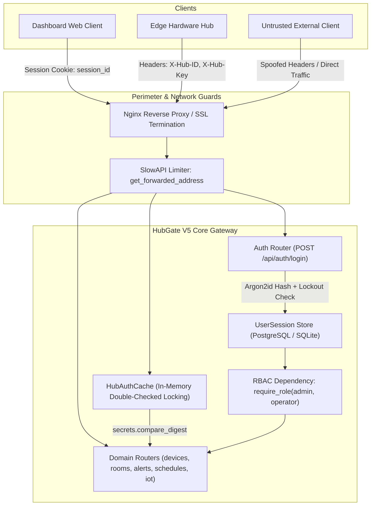
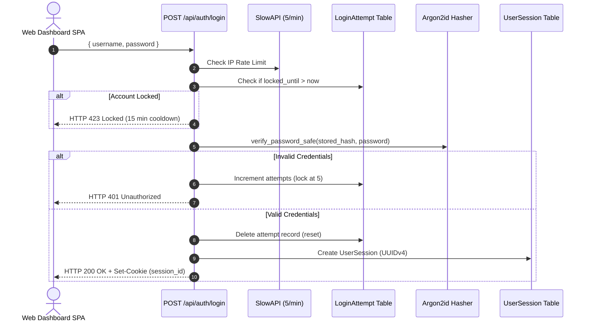
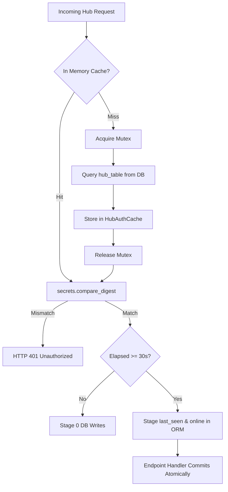

# HubGate V5 Security & Authentication Architecture

HubGate V5 operates a dual authentication topology: user session authentication (for web operators and administrators) and pre-shared API key authentication (for edge hardware gateways). Access control is enforced across domain routers through role-based access control (RBAC), rate-limiting middleware, and database-backed brute-force lockout mechanisms.



---

## 1. User Authentication & Session Lifecycle

Web user authentication is implemented in `server/auth.py` and exposed via `server/app/routers/auth.py`:



### Credential Hashing & Timing-Safe Verification
- **Argon2id Hasher**: Initialized via `argon2.PasswordHasher()`. The underlying implementation applies RFC 9106 default parameters:
  - Memory cost: 65,536 KiB (64 MB)
  - Time cost: 3 iterations
  - Parallelism: 4 concurrent lanes
  - Hash length: 32 bytes
  - Salt length: 16 bytes
- **Username Enumeration Mitigation**: `verify_password_safe(stored_hash, password)` provisions a cryptographically random dummy hash at server startup (`DUMMY_PASSWORD = secrets.token_urlsafe(32)`, `DUMMY_HASH = ph.hash(DUMMY_PASSWORD)`). When a submitted username does not exist in the `users` table, the verifier evaluates against `DUMMY_HASH`, equalizing execution latency to prevent timing-based user enumeration.

### Session Management & Cookie Security
- **Database Storage**: Active sessions are persisted in the `sessions` table (`UserSession`), storing `session_id` (UUIDv4), `user_id` (FK to `users.id`), `expires_at`, and `created_at`. Lookups are accelerated by composite index `ix_sessions_user_expires(user_id, expires_at)`.
- **Cookie Attributes**:
  - `HttpOnly=True`: Disallows client-side JavaScript access (`document.cookie`), mitigating XSS session theft.
  - `SameSite="lax"`: Mitigates cross-site request forgery on cross-origin subrequests while permitting top-level navigation.
  - `Secure`: Dynamically set based on `request.url.scheme == "https" or request.headers.get("x-forwarded-proto") == "https"`.
  - `Path=/`, `Max-Age=7200` (2 hours).
- **Dual Expiration Policy**:
  - **Sliding Window (2 Hours)**: Every valid request passing through `verify_session` extends `expires_at` to `min(now + 2 hours, absolute_expiry)`.
  - **Absolute Ceiling (12 Hours)**: Irrespective of user activity, `absolute_expiry = created_at + 12 hours`. Once `now > absolute_expiry`, the session row is deleted from the database and `SessionExpired` is raised.
- **Session Cleanup**: Expired sessions trigger `SessionExpired`, intercepted by `session_expired_handler` in `server/app/main.py`. It returns HTTP 401 Unauthorized, formats CORS headers, and deletes the client cookie via `response.delete_cookie("session_id", max_age=0)`.

### Brute-Force Account Lockout
- **State Tracking**: Failure counts are recorded per normalized (trimmed, lowercased) username in the `login_attempts` table (`username`, `attempts`, `last_attempt_at`, `locked_until`).
- **Lockout Policy**: Upon 5 consecutive failed login attempts, `locked_until` is set to `now + 15 minutes`. Inbound requests during lockout immediately receive HTTP 423 Locked without invoking Argon2id. A successful authentication deletes the attempt record.

---

## 2. Edge Hub Authentication & Throttled Heartbeat

Edge hardware hubs communicate with HubGate V5 using custom HTTP request headers:
- `X-Hub-ID`: Registered hub identifier (e.g. `RASPI_HUB_01`).
- `X-Hub-Key`: Secret API key assigned to the hub.

### Throttled In-Memory Validation (`HubAuthCache`)
To prevent high-frequency telemetry ingestion from causing database lock contention, authentication is delegated to `HubAuthCache` (`server/app/dependencies.py`):



- **Lock-Free Read Path**: Cached entries (`HubCacheEntry`: `hub_name`, `hub_key`, `is_active`, `last_db_persist_ts`) are read without acquiring a mutex. Lock acquisition occurs only during cache misses (double-checked locking), timestamp updates, or cache invalidation (`invalidate(hub_id)`).
- **Constant-Time Verification**: API keys are evaluated using `secrets.compare_digest` to prevent timing analysis.
- **Heartbeat Staging**: `stage_hub_heartbeat(hub)` updates `hub.last_seen` and `hub.status = "online"` in memory if $\ge 30.0$ seconds have elapsed. It executes **zero** database commits inside the dependency, eliminating the auth double-commit flaw (CRIT-01). The endpoint handler commits heartbeat, telemetry, presence, and alerts in a single atomic database transaction.

### Hub Registration & Bootstrap Key
- **Pre-Registered Hubs**: Registered by administrators via `POST /api/admin/hubs`.
- **Edge Self-Pairing**: Unregistered hubs submitting `POST /api/hubs/pair` must provide `X-Hub-Key` matching `HUB_BOOTSTRAP_KEY` from the environment. Successful bootstrap creates a dormant record (`is_active=False`, `status="offline"`) returning HTTP 202 Accepted (`pending_approval`) until explicitly activated by an administrator via `POST /api/hubs/{id}/approve`.

---

## 3. Role-Based Access Control (RBAC) Enforcement

HubGate V5 enforces role segregation across three privilege tiers: `admin`, `operator`, and `viewer` (any authenticated user session).

### Dependency Implementation
RBAC factory is declared in `server/auth.py`:
```python
def require_role(*allowed_roles: str):
    def dependency(current_user: User = Depends(get_current_user)) -> User:
        if current_user.role not in allowed_roles:
            raise HTTPException(status_code=status.HTTP_403_FORBIDDEN, detail="Operation not permitted")
        return current_user
    return dependency
```

### Complete Endpoint Access Control Matrix

| Endpoint | Method | Authentication | Required Role / Identity | Purpose |
|---|---|---|---|---|
| `/health`, `/api/health` | GET | None | Public | Gateway & DB Liveness Check |
| `/api/auth/login` | POST | None (Rate Limited) | Public | User Login (5/min, Lockout) |
| `/api/auth/logout` | POST | Session Cookie | Any Authenticated User | Session Invalidation |
| `/api/auth/me` | GET | Session Cookie | Any Authenticated User | Current User Profile |
| `/api/admin/hubs` | POST | Session Cookie | `admin` | Register Pre-Shared Hub |
| `/api/hubs` | GET | Session Cookie | Any Authenticated User | List Hubs & Paired Devices |
| `/api/hubs/pair` | POST | Header (`X-Hub-Key`) | Bootstrap Key or Existing Hub | Edge Hub Auto-Enrollment |
| `/api/hubs/{id}/approve` | POST | Session Cookie | `admin` | Activate Pending Hub |
| `/api/hubs/{id}/revoke` | POST | Session Cookie | `admin` | Suspend Active Hub |
| `/api/hubs/{id}` | DELETE | Session Cookie | `admin` | Hard-Delete Empty Hub (409 if paired) |
| `/api/gateways/{id}/room` | POST | Session Cookie | `admin` | Assign Hub to Room |
| `/api/rooms` | GET | Session Cookie | Any Authenticated User | List Rooms with Device Counts |
| `/api/rooms` | POST | Session Cookie | `admin` | Create Facility Room |
| `/api/rooms/{id}` | PATCH | Session Cookie | `admin` | Update Room Metadata |
| `/api/rooms/{id}` | DELETE | Session Cookie | `admin` | Delete Room (400 if devices assigned) |
| `/api/rooms/{id}/map` | GET | Session Cookie | Any Authenticated User | Room Floor Plan & Live Markers |
| `/api/rooms/{id}/floor-plan` | POST | Session Cookie | `admin` | Upload Floor Plan Image |
| `/api/rooms/sparklines` | GET | Session Cookie | Any Authenticated User | 2-Pass CTE Room Sparklines |
| `/api/devices` | GET | Dual (Cookie or Header) | Any User OR Active Hub | List Devices (Read-Only) |
| `/api/devices/{id}` | GET | Session Cookie | Any Authenticated User | Single Device Details & Latest State |
| `/api/devices/{id}/history`| GET | Session Cookie | Any Authenticated User | Downsampled V2 Telemetry History |
| `/api/devices/{id}/approve`| POST | Session Cookie | `admin` | Whitelist Pending Device |
| `/api/devices/{id}/pair` | POST | Session Cookie | `admin` | Pair Device to Room & Coordinates |
| `/api/devices/{id}/unpair` | POST | Session Cookie | `admin` | Unpair Device from Room & Deactivate |
| `/api/devices/{id}/thresholds`| PUT | Session Cookie | `admin` | Update Alert Thresholds |
| `/api/devices/{id}/command`| POST | Session Cookie | `admin` (reset), `operator` (action) | Queue Downlink Device Command |
| `/api/commands/{id}` | GET | Session Cookie | Any Authenticated User | Check Command Delivery Status |
| `/api/alerts` | GET | Session Cookie | Any Authenticated User | Filter & Paginate Alerts |
| `/api/iot` | POST | Header (`X-Hub-ID/Key`) | Active Edge Hub | Ingest Single Telemetry Point |
| `/api/iot/batch` | POST | Header (`X-Hub-ID/Key`) | Active Edge Hub | Ingest Batch (up to 1000 points) |
| `/api/iot/unapproved` | POST | Header (`X-Hub-ID/Key`) | Active Edge Hub | Register Discovered Unapproved Device |
| `/api/hub/commands` | GET | Header (`X-Hub-ID/Key`) | Active Edge Hub | Poll Pending Downlink Commands |
| `/api/hub/commands/{id}/delivered` | POST | Header (`X-Hub-ID/Key`) | Active Edge Hub | Acknowledge Command Execution |
| `/api/schedules` | GET | Session Cookie | Any Authenticated User | List Active Schedules |
| `/api/schedules/preview` | GET | Session Cookie | Any Authenticated User | Preview Cron Fire Times |
| `/api/schedules` | POST | Session Cookie | `admin` | Create Cron Automation Job |
| `/api/schedules/{id}` | GET | Session Cookie | Any Authenticated User | Get Schedule Detail |
| `/api/schedules/{id}` | PATCH | Session Cookie | `admin` | Update Cron Automation Job |
| `/api/schedules/{id}` | DELETE | Session Cookie | `admin` | Delete Cron Automation Job |
| `/api/schedules/{id}/run-now` | POST | Session Cookie | `admin` | Trigger Immediate Job Execution |

---

## 4. Rate Limiting Architecture (SlowAPI)

Rate limiting is enforced globally through SlowAPI (`server/app/core/rate_limit.py`) using client IP tracking:
- **Authentication**: `5/minute` on `/api/auth/login`.
- **Edge Telemetry Ingestion**: `120/minute` on `/api/iot`, `60/minute` on `/api/iot/batch` and `/api/iot/unapproved`.
- **Edge Command Polling**: `30/minute` on `/api/hub/commands` and delivered acknowledgments.
- **Admin & Configuration Writes**: `30/minute` on device pairing, threshold updates, rooms, schedules, and command dispatch.
- **Read Queries**: `60/minute` on devices, room maps, sparklines, history, alerts, and schedules.
- **Hub Bootstrap**: `10/minute` on `/api/hubs/pair` and `/api/admin/hubs`.

When a limit quota is exhausted, SlowAPI raises `RateLimitExceeded`, handled by `_rate_limit_exceeded_handler` in `server/app/main.py`, returning HTTP 429 Too Many Requests.

---

## 5. Security Attack Surface & Identified Production Hardening Gaps

A comprehensive architectural security audit reveals ten critical vulnerabilities and hardening gaps:

### SEC-01: Client IP Spoofing via Forwarded Headers
- **Location**: `server/app/core/rate_limit.py` (`get_forwarded_address`).
- **Mechanism**: The helper extracts `X-Real-IP` or the first component of `X-Forwarded-For` without validating that `request.client.host` originates from a trusted reverse proxy (`ForwardedAllowIPS = 127.0.0.1` defined in `config.py`).
- **Impact**: Any direct client accessing port 8000 can forge arbitrary IP addresses in `X-Real-IP: 1.2.3.4`, completely circumventing SlowAPI rate limits or maliciously causing denial of service against victim IP addresses.
- **Remediation**: Validate `request.client.host in TRUSTED_PROXIES` before evaluating `X-Real-IP` or `X-Forwarded-For`. Fall back strictly to `request.client.host` if untrusted.

### SEC-02: Missing Explicit CSRF Tokens for Mutating Endpoints
- **Location**: `server/app/routers/` (all state-changing `POST`, `PUT`, `PATCH`, `DELETE` routes).
- **Mechanism**: Protection relies exclusively on cookie `SameSite="lax"`. While this blocks cross-origin subresource requests, top-level window navigations and legacy browser quirks can still transmit cookies.
- **Impact**: Potential CSRF exposure on state-changing endpoints if the frontend SPA is hosted across divergent subdomain origins.
- **Remediation**: Implement double-submit CSRF cookie verification or require custom headers (`X-Requested-With` or `X-CSRF-Token`) on all mutating endpoints.

### SEC-03: Inconsistent RBAC Enforcement Mechanisms
- **Location**: `server/app/routers/schedules.py` (lines 188-191, 291, 359) and `server/app/routers/commands.py` (lines 31-41).
- **Mechanism**: Handlers inject `get_current_user` and imperatively verify `if current_user.role != "admin": raise HTTPException(403)` rather than declaring `current_user: User = Depends(require_role("admin"))` in route signatures.
- **Impact**: Architectural inconsistency, elevated risk of missed permission checks during route maintenance, and omission of declarative security requirements from generated OpenAPI documentation.
- **Remediation**: Refactor all privileged routes to employ the declarative `require_role(...)` dependency factory.

### SEC-04: Plaintext Storage of Edge Hub API Keys
- **Location**: `server/modelsv5.py` (`hub_table.hub_key`).
- **Mechanism**: Hub keys are stored as plaintext strings in the database to enable lookup into `HubAuthCache`.
- **Impact**: A database read leak (e.g. SQL injection or database backup compromise) exposes all edge hub API keys, granting attackers the ability to forge telemetry and intercept downlink commands.
- **Remediation**: Store SHA-256 or Argon2id hashes of `hub_key`. Edge hubs supply plaintext keys in `X-Hub-Key`; HubGate validates against stored hashes using constant-time digest verification.

### SEC-05: Inadvertent Database Write on Read Endpoints
- **Location**: `server/app/routers/devices.py` (lines 576-577) and `server/app/routers/commands.py` (lines 75-76).
- **Mechanism**: When `GET /api/devices` or `GET /api/hub/commands` is invoked with edge hub credentials, `stage_hub_heartbeat(hub)` mutates the ORM object, followed by `if db.dirty: db.commit()`.
- **Impact**: Violates the read-only invariant for `GET` requests, creating write lock contention on SQLite edge deployments during periodic hub polling.
- **Remediation**: Remove `db.commit()` from all `GET` routes. Edge hub heartbeats must strictly commit via ingestion routes (`/api/iot`) or dedicated heartbeat ping routes.

### SEC-06: Missing Device-to-Hub Ownership Validation on Telemetry Ingestion
- **Location**: `server/app/routers/iot.py` (lines 194-196 in `receive_iot`, lines 298-305 in `receive_iot_batch`).
- **Mechanism**: Ingestion verifies that the submitting hub is authenticated (`verify_hub_identity`) and that the target device exists and is active (`dev.is_active == True`). However, it never checks whether `dev.hub_id == hub.hub_id`.
- **Impact**: Any valid edge hub can inject spoofed sensor telemetry for devices belonging to entirely different hubs, facilities, or rooms.
- **Remediation**: Enforce `if dev.hub_id != hub.hub_id: raise HTTPException(403, "Device does not belong to this hub")` in both single and batch ingestion endpoints.

### SEC-07: Unbounded Session Store Accumulation (Missing Stale Session GC)
- **Location**: `server/modelsv5.py` (`UserSession`) and `server/auth.py`.
- **Mechanism**: Session deletion occurs only on explicit logout (`POST /api/auth/logout`) or when an expired session token is presented in an inbound request. If a user closes the browser without logging out, expired session rows persist indefinitely.
- **Impact**: Continuous table bloat in the `sessions` table, degrading B-tree index performance on `ix_sessions_user_expires`.
- **Remediation**: Schedule a recurring APScheduler cleanup task (`delete from sessions where expires_at < now()`) to prune expired sessions hourly.

### SEC-08: Non-Explicit Argon2id Parameter Configuration
- **Location**: `server/auth.py` (line 16: `ph = PasswordHasher()`).
- **Mechanism**: Instantiated with default constructor arguments. While current library defaults align with RFC 9106, upgrading `argon2-cffi` or deploying across divergent platforms can alter memory and iteration costs without warning.
- **Impact**: Non-deterministic hash parameters across environments and potential performance degradation on resource-constrained nodes.
- **Remediation**: Explicitly pass production parameters: `PasswordHasher(time_cost=3, memory_cost=65536, parallelism=4, hash_len=32, salt_len=16)`.

### SEC-09: Unstructured Exception Payloads & Information Disclosure
- **Location**: Across all routers (`server/app/routers/`).
- **Mechanism**: Errors are raised via ad-hoc strings in `HTTPException(detail="...")`, frequently mixing Indonesian and English messages. Furthermore, uncaught exceptions bubble to FastAPI's default handler without standardized error schemas or correlation IDs.
- **Impact**: Client applications cannot reliably parse error conditions programmatically, and internal database error messages can leak schema details.
- **Remediation**: Implement a centralized `ErrorResponse` schema (`code`, `message`, `correlation_id`, `details`) and register global exception handlers for `SQLAlchemyError`, `RequestValidationError`, and generic `Exception`.

### SEC-10: Write Amplification from Session Sliding Window on Read Routes
- **Location**: `server/auth.py` (`verify_session`, lines 126-127).
- **Mechanism**: Every request authenticated via session cookie triggers `db_session.expires_at = min(now + 2h, absolute_expiry)` followed by `db.commit()`.
- **Impact**: Every authenticated `GET` request issues an `UPDATE sessions` query and commits a write transaction. On SQLite WAL, this forces serialized write locks for concurrent read traffic; on PostgreSQL, it generates intense UPDATE churn and VACUUM pressure.
- **Remediation**: Throttle session sliding updates: only execute the `UPDATE` and `db.commit()` if `expires_at - now < 90 minutes` (half of the sliding window).
